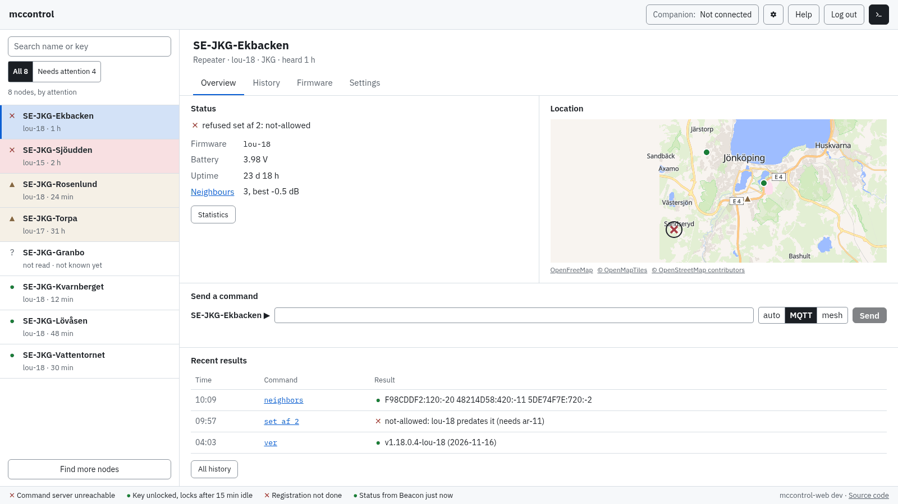
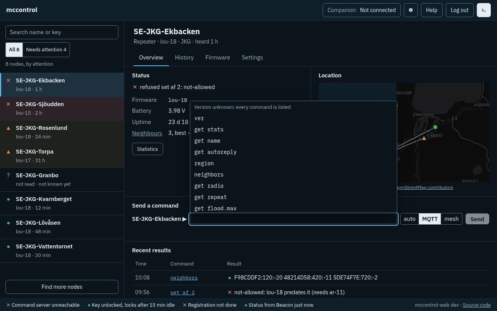
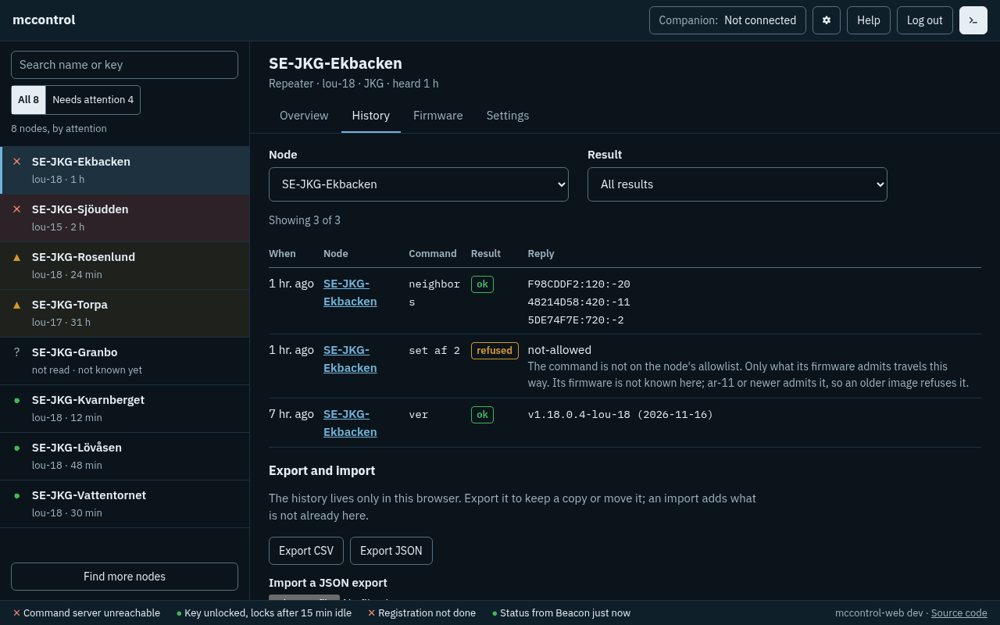
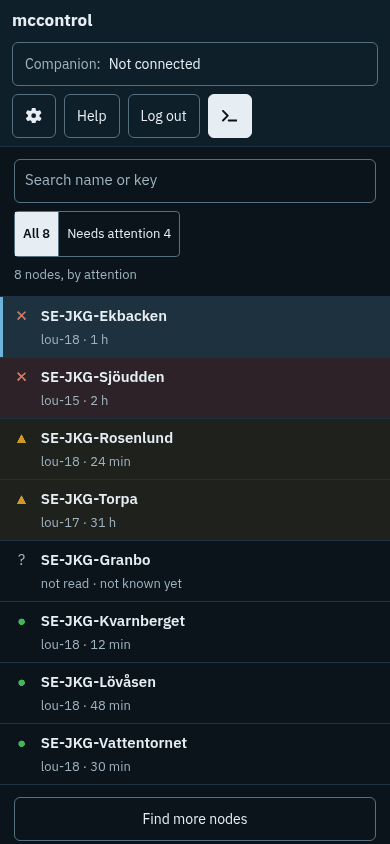
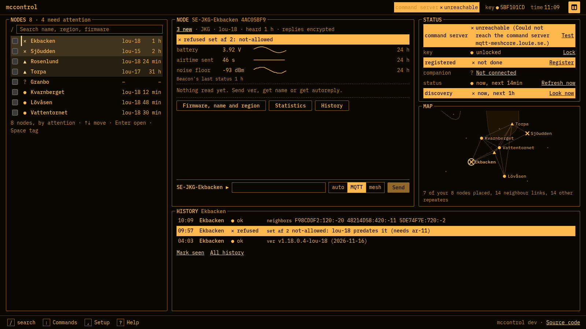
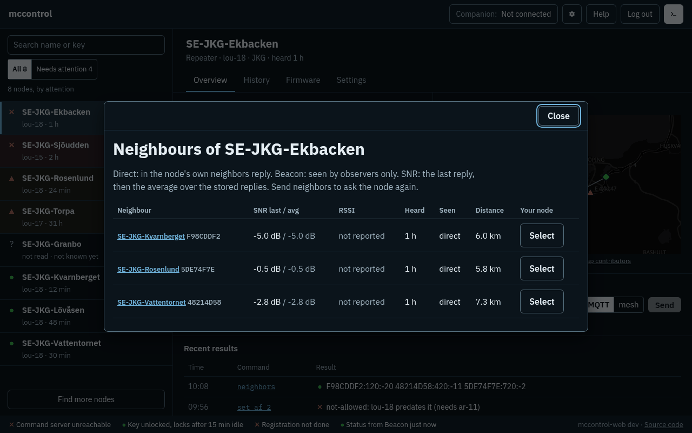

# mccontrol-web

mccontrol in the browser, for the people who run MeshCore Observer repeaters: sign a command
with a key kept in the browser, send it to one repeater or several over MQTT, or over the mesh
through your own companion radio (USB or Bluetooth), and see what came back, with a history per
node. Live at [mccontrol.meshcoresverige.se](https://mccontrol.meshcoresverige.se).

A static page: plain HTML, CSS and ES modules, no build step, no server of its own, no analytics.
The key is made or imported in the browser, stored encrypted under a passphrase, and never sent
anywhere except inside a signature or a backup file you save yourself.

What it is not: not the terminal tool, not a command server, not firmware. It never changes a repeater's
key, identity or radio (the deny list keeps those to the serial cable).


## Two layouts

**Standard** (the default): a list of your nodes and one node's detail, in dark or light, with a
colour-blind mode.

| Light | Commands | History | Phone |
|---|---|---|---|
| [](docs/screenshots/standard-light-1600.png) | [](docs/screenshots/standard-dark-1280-commands.png) | [](docs/screenshots/standard-dark-1280-history.png) | [](docs/screenshots/standard-dark-phone.png) |

**Retro**: a board of tiles (NODES, NODE, STATUS, MAP, HISTORY) with a command palette, in
amber, green, dark or light. Settings switch between the two.



| Palette | Companion | Result | Node details | Neighbours |
|---|---|---|---|---|
| [](docs/screenshots/retro-palette.png) | [](docs/screenshots/retro-companion-chooser.png) | [](docs/screenshots/retro-result.png) | [](docs/screenshots/retro-node-details.png) | [](docs/screenshots/standard-dark-neighbours.png) |

Setup: [key](docs/screenshots/retro-setup-key.png) · [node](docs/screenshots/retro-setup-node.png) ·
[area](docs/screenshots/retro-setup-area.png) · [groups](docs/screenshots/retro-setup-groups.png) ·
[sets](docs/screenshots/retro-setup-sets.png) · [warnings](docs/screenshots/retro-setup-warnings.png) ·
[display](docs/screenshots/retro-setup-display.png). Green: [board](docs/screenshots/retro-green-1600.png),
phone: [retro](docs/screenshots/retro-phone.png).

The nodes, names and key in the pictures are invented. `node web/test/smoke/readme-shots.mjs`
makes them again from the code as it is (headless Chrome, the smoke test's fake fleet).

## How the four repositories relate

- **mccontrol-web** (this one): the browser app and its Cloudflare Pages deploy.
- [mccontrol-cli](https://github.com/sweden-mesh/mccontrol-cli): the same tool in a terminal
  (Python), and the reference implementation; a key backup file moves between the two.
- [mccontrol-spec](https://github.com/sweden-mesh/mccontrol-spec): the wire format, the command
  table, the deny list, the help texts and the shared test vectors. This app keeps a copy of one
  tag in `web/lib/data/` and `web/test/`, recorded in `spec.lock`; its tests prove it gives
  byte-identical envelopes, results and checks to the CLI.
- [mccontrol](https://github.com/sweden-mesh/mccontrol): a landing page pointing at the three.

The firmware it talks to is [MeshCore-lou](https://github.com/sweden-mesh/MeshCore-lou).

## Run, test, deploy

```
python3 -m http.server -d web 8000 --bind 127.0.0.1    # then open http://127.0.0.1:8000/
node --test "web/test/**/*.test.js"                    # node 22, offline
node web/test/smoke/run.mjs                            # every modal in headless Chrome
node web/test/smoke/filled.mjs                         # the filled board, phone and desktop
node scripts/spec-sync.mjs v0.1.0                      # copy a mccontrol-spec tag; --check compares
node scripts/web-dist.mjs --out dist/web --version web-v0.1.0 --commit "$(git rev-parse HEAD)"
```

`web-dist.mjs` makes the deployable copy (versions stamped, `integrity.json` with the SHA-256 of
every file); `.github/workflows/web-deploy.yml` tests every push and deploys `main` to the Pages
project `mccontrol` when the repository variable `DEPLOY_ENABLED` is `true`. Conventions, layout
and the design notes are in [web/README.md](web/README.md).

## Licence

MIT, see [LICENSE](LICENSE). Vendored libraries keep their own licences under `web/vendor/`.
